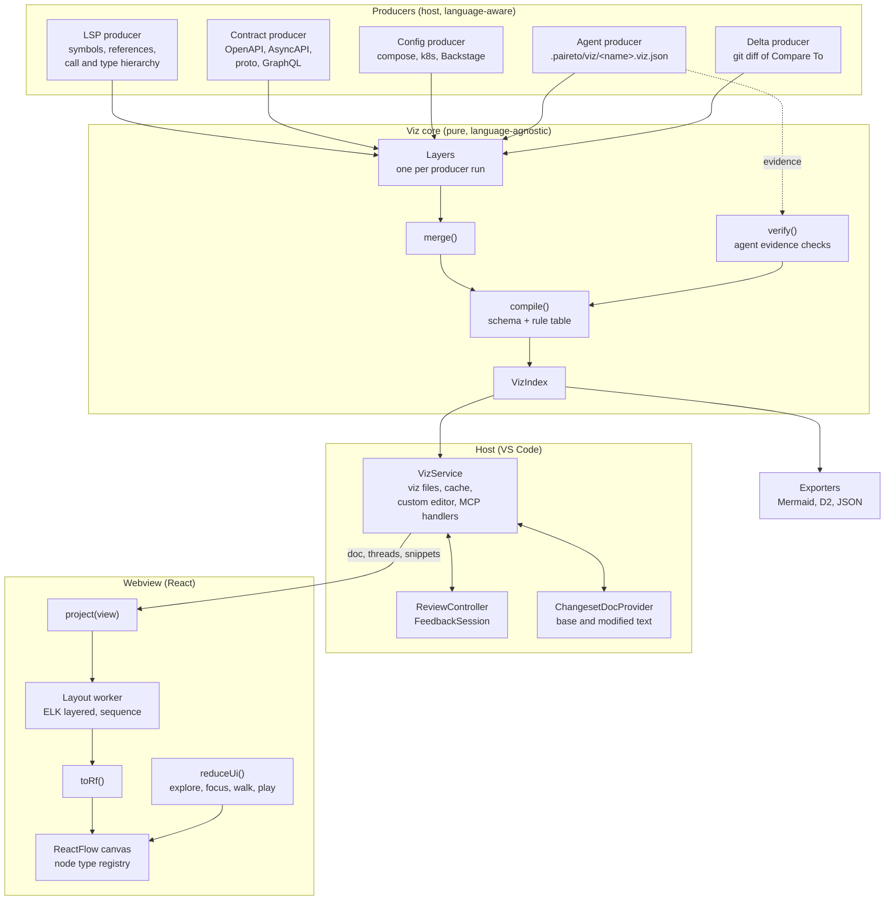

# Shared viz core: architecture

This document describes the layers of the shared visualisation core. The data model is in [03-model.md](03-model.md). The protocols are in [04-protocols.md](04-protocols.md).

## Goals

- One model for component graphs, class and entity diagrams, and sequence diagrams.
- Two kinds of producer write into the same model. Programmatic producers use LSP, contract files and config. The agent edits a JSON file in `.paireto/viz/`, and MCP tools generate, check and open it.
- The agent adds to a programmatic graph. It does not draw the whole graph again.
- Every element can open code, show a code snippet, and hold a review thread.
- Walkthrough, step-through and flow playback use one mechanism.
- No part of the core knows a programming language. Language knowledge stays in producers.
- Export to Mermaid for portability.

## Decision: model and views, not UML

UML is a notation. It is not a good interchange model for this tool.

- UML has no place for delta, provenance, file references or review threads.
- A sequence diagram and a class diagram in UML are two separate models. We want one set of elements that several diagrams show.
- No existing format has typed nesting, members, sequences, an open metadata bag and a JSON Schema together. JGF has the schema but no nesting. ELK JSON has nesting and ports but no semantics. Structurizr has the right split but only four fixed levels and no members.

The core copies the split that Structurizr and LikeC4 use:

- A **model** holds elements and relations. It is a graph with nesting.
- A **view** selects part of the model and names how to draw it: as a graph, as class boxes, or as a sequence.
- A **walk** is an ordered list of steps over relations. A sequence view draws a walk. A graph view plays a walk back as highlights.

UML becomes a profile. A class node with members, and `extends` / `implements` edges, draw as UML class boxes. The same nodes can also show as plain cards in a component view.

## Layers

### Producers

A producer writes one **layer**. A layer is a partial model with a provenance tag. Producers live on the host because they need VS Code APIs, the file system or git.

- **LSP producer.** Uses `vscode.execute*Provider` commands, not raw LSP. This works for providers that do not use LSP, such as the TS extension. It probes each capability for each language and marks the layer `partial` when one is missing. See [05-seams.md](05-seams.md) for the coverage table.
- **Delta producer.** Takes the Compare To diff and writes the delta overlay: status for each element, `signature` vs `body` for members, line counts and spans with a side. The logic comes from #77 `fileDiff.ts` and `lineDiff.ts`.
- **Contract and config producers.** Turn API contracts and deploy config into endpoint and service nodes. These are later phases.
- **Agent producer.** The agent writes its layer as a JSON file with its normal file tools. It can refer to ids from other layers. See [04-protocols.md](04-protocols.md#1-viz-files-and-mcp-tools).

### Core

The core is pure TypeScript. It has no VS Code, React or xyflow imports.

- `merge(layers)` joins layers by element id. The rules are in [03-model.md](03-model.md#merge-rules).
- `compile(doc, env)` runs the zod schema, then a rule table. Each rule names the producers it applies to. This generalises #74 `compile.ts`.
- `verify(edge, env)` checks the evidence on agent seam edges and sets a verification status.
- `buildIndex(doc)` builds id maps, adjacency, walk membership and search text. It comes from #74 `index.ts`. The host builds it once and sends it with the doc, so the webview does not build it again.

### Host

- `VizService` owns the viz files, the cache, the custom editor for `*.viz.json`, and the MCP handlers. It keeps the injected ports from #74.
- Only the agent makes a viz. Anyone can open one: from the file, from the viz button (most recent viz), from the switcher, or from `paireto_viz_open`.
- Comments go through the existing `ReviewController` and `FeedbackSession`, as in #77. No second comment system.
- Code snippets come from `ChangesetDocProvider`, so both the base and the modified side work.

### Webview

- `project(doc, view)` returns the elements a view shows. Grouping ("by folder", "by links" from #77) is a projection rule, not layout code.
- Layout runs in a Web Worker. ELK layered draws graph and class views. The sequence layout from #74 draws sequence views.
- `toRf(scene)` converts a scene into xyflow nodes and edges. A registry maps node kinds to React components: `card`, `classBox`, `group`, `lifeline`, `message`, `note`.
- `reduceUi` from #74 owns interaction state. It replaces the local state in #77 `Diagram.tsx`.

## Module map

This is a proposal. Names can change.

| Path | Holds | Source |
| --- | --- | --- |
| `src/viz/model/` | Types, zod schemas, merge, compile, rules, index, refs | #74 model, rewritten for the new IR |
| `src/viz/producers/lsp/` | Symbol extraction, relation queries, capability probe | #77 `symbols.ts`, `outline.ts`, `relations.ts` |
| `src/viz/producers/delta/` | Delta overlay from the Compare To diff | #77 `fileDiff.ts`, `lineDiff.ts` |
| `src/viz/producers/agent/` | Viz file read and write, MCP handlers, evidence verification | #74 `VizService` handlers |
| `src/viz/views/` | Projection rules, view presets | #77 grouping, new |
| `src/viz/layout/` | ELK adapter, sequence layout, worker entry | #74 `layout/*` |
| `src/viz/export/` | Mermaid, D2 | #74 `mermaid.ts` |
| `src/viz/host/` | `VizService`, `VizPanel`, store | #74 host |
| `src/viz/webview/` | React components, `toRf`, `reduceUi`, node registry | #74 webview, #77 class box and notes UI |
| `src/review/` | `DiagramAnchor` on `ReviewThread` | #77 |

## Delivery order

Each step ends in a state that works and has tests.

1. Move #74 onto the new IR. Ids, refs, groups as elements, edge ids. The overview and sequence views keep working.
2. Add the `classBox` node type and the class view. Port the #77 symbol producer and delta producer as layers. Retire the #77 SVG renderer.
3. Move #77 notes onto element refs, with code anchors that use `relocateReviewAnchor`. Notes work on every view.
4. Add the `.paireto/viz/*.viz.json` files, the custom editor, the switcher, and the `paireto_viz_create`, `paireto_viz_check` and `paireto_viz_refresh` tools. The agent adds walks, roles and seam edges on top of a programmatic graph.
5. Add evidence verification for seam edges.
6. Add code snippet preview and the exporters.
7. Add contract and config producers.
