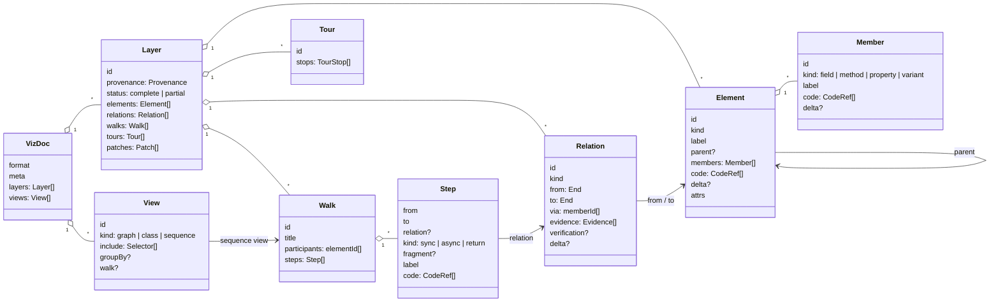

# Shared viz core: data model

This document describes the intermediate representation (IR) that every producer writes and every view reads. The TypeScript below is a sketch for review. It is not final code.

## Overview



## Identity

Ids are opaque strings. The core does not parse them. This removes the id regex and the `from>to` ref grammar from #74, which block symbol ids.

| Producer | Id form | Example |
| --- | --- | --- |
| LSP | `sym:<repo>/<path>#<qualified name>` | `sym:paireto/src/review/ReviewController.ts#ReviewController` |
| LSP member | `sym:<repo>/<path>#<qualified name>.<member>[~n]` | `sym:paireto/src/review/ReviewController.ts#ReviewController.addDiagramComment` |
| Contract | `api:<contract path>#<key>` | `api:openapi.yaml#POST /orders` |
| Delta | `file:<repo>/<path>` | `file:paireto/src/viz/protocol.ts` |
| Agent | `a:<name>` | `a:order-queue` |

- The symbol form follows SCIP descriptors in spirit. It is stable across runs while the qualified name does not change. `~n` tells overloads apart, as in #77.
- An agent id gets the `a:` prefix from the host. The agent writes only `order-queue`. An agent cannot make a `sym:` id. It can only refer to one that a producer made.
- Every relation has an id. A producer that does not give one gets `<from>-><to>:<kind>[~n]`. This allows more than one edge between two nodes, and self edges.

A **ref** points at anything a user can select or comment on.

```ts
type VizRef =
  | { element: ElementId }
  | { member: MemberId }
  | { relation: RelationId }
  | { step: { walk: WalkId; index: number } };
```

Structured refs replace the string grammar. The viz file accepts a bare string as shorthand for `{ element }` or `{ relation }`, because ids are unique across both sets in one doc.

## Elements

```ts
interface Element {
  id: ElementId;
  kind: ElementKind;
  label: string;
  parent?: ElementId;
  stereotype?: string;
  members?: Member[];
  code?: CodeRef[];
  delta?: Delta;
  role?: string;
  attrs?: Record<string, string | number | boolean>;
}

type CoreElementKind =
  | "system" | "service" | "package" | "module" | "file"
  | "class" | "interface" | "enum" | "struct" | "function"
  | "endpoint" | "topic" | "datastore" | "cache" | "external" | "actor" | "ui";

type ElementKind = CoreElementKind | `x:${string}`;
```

- `parent` gives nesting to any depth. A group is an element with children, so refs can target it. #74 groups are free text and cannot be targets.
- `kind` is a small closed core list plus an open `x:` extension. Renderers fall back to a generic card for unknown kinds. This removes React words such as `hook` and `render` from the core list.
- `members` turns an element into a class box in a class view. In a graph view the same element is a card, with a member count.
- `stereotype` holds UML text such as `«module»` or `«record»`.

## Members

```ts
interface Member {
  id: MemberId;
  kind: "field" | "method" | "property" | "constructor" | "variant";
  label: string;
  short?: string;
  visibility?: "public" | "private" | "protected" | "internal";
  isStatic?: boolean;
  isAbstract?: boolean;
  code?: CodeRef[];
  delta?: Delta;
}
```

This comes from #77 `UmlMember`. Visibility is a word, not a UML symbol. The class box renderer turns it into `+ - # ~`.

## Relations

```ts
interface Relation {
  id: RelationId;
  kind: RelationKind;
  from: End;
  to: End;
  label?: string;
  via?: MemberId[];
  roles?: { from?: string; to?: string };
  multiplicity?: { from?: string; to?: string };
  evidence?: Evidence[];
  verification?: "verified" | "partial" | "unverified" | "failed";
  delta?: Delta;
  attrs?: Record<string, string | number | boolean>;
}

interface End { element: ElementId; member?: MemberId; port?: string }

type CoreRelationKind =
  | "contains" | "imports" | "calls" | "uses"
  | "extends" | "implements" | "association" | "aggregation" | "composition"
  | "reads" | "writes" | "publishes" | "subscribes"
  | "http" | "rpc" | "renders";

type RelationKind = CoreRelationKind | `x:${string}`;
```

- `End.member` lets an edge start at a member row of a class box. `via` lists the members that cause the edge, as in #77.
- `evidence` and `verification` are for seam edges. See [05-seams.md](05-seams.md).
- The renderer maps each kind to a line style and arrowhead. UML notation is one mapping: `extends` is a hollow triangle, `implements` is a dashed hollow triangle, `composition` is a filled diamond.

## Delta

```ts
interface Delta {
  status: "added" | "removed" | "modified" | "unchanged";
  detail?: "signature" | "body" | "header" | "moved";
  counts?: { added: number; removed: number };
  spans?: CodeRef[];
}
```

This merges the #74 and #77 vocabularies. #77 calls a removed item `removed` and #74 calls it `deleted`. The core uses `removed`. Delta is an overlay, so it can sit on an element, a member, a relation or a step.

## Code references

```ts
interface CodeRef {
  repo: string;
  path: string;
  side: "base" | "modified";
  range?: { start: number; end: number };
  symbol?: ElementId | MemberId;
}
```

- `side` fixes the gap in #74, where a line in a deleted file has no meaning.
- Lines are 0-based, as in `ReviewThread.line`.
- The host turns a `CodeRef` into a snippet or an open-diff action. See [04-protocols.md](04-protocols.md#code-snippets).

## Walks and tours

```ts
interface Walk {
  id: WalkId;
  title: string;
  summary?: string;
  participants: ElementId[];
  steps: Step[];
  delta?: Delta;
}

interface Step {
  from: ElementId;
  to: ElementId;
  relation?: RelationId;
  kind: "sync" | "async" | "return" | "create" | "destroy";
  label: string;
  request?: string;
  response?: string;
  fragment?: { kind: "alt" | "opt" | "loop" | "par" | "break" | "try"; label?: string; id: string };
  phase?: string;
  code?: CodeRef[];
  delta?: Delta;
}

interface Tour {
  id: string;
  title: string;
  stops: { title: string; body: string; view: ViewId; focus: VizRef[] }[];
}
```

- A **walk** is a protocol or a logical flow. A sequence view draws it with lifelines. A graph view plays it back by highlighting `step.relation` one step at a time. #74 had two models for these. The core has one.
- `fragment` adds `alt`, `opt`, `loop`, `par`, `break` and `try` blocks, with the same words as LikeC4. #74 has no fragments.
- A **tour** is the narrated walkthrough from #74. A stop names a view, so one tour can move from the overview to a sequence and back. In #74 a walkthrough step cannot mix stages.
- "Next change" from #77 is a generated tour. Its stops are the changed members in rank order.

## Views

```ts
interface View {
  id: ViewId;
  kind: "graph" | "class" | "sequence";
  title: string;
  include: Selector[];
  exclude?: Selector[];
  groupBy?: "parent" | "folder" | "component" | "none";
  depth?: number;
  walk?: WalkId;
  lanes?: ElementId[];
}

type Selector =
  | { ref: VizRef }
  | { kind: ElementKind }
  | { changed: true }
  | { neighbours: VizRef; hops: number }
  | { under: ElementId };
```

- A view stores selectors, not a list of elements. A programmatic graph can grow and the view still works.
- `groupBy: "component"` is the "By links" frame from #77. `groupBy: "folder"` is "By folder".
- `lanes` gives the #74 lane columns. A lane is an element, often a `system` or `service`.

## Provenance and layers

```ts
interface Layer {
  id: LayerId;
  provenance: { source: "lsp" | "delta" | "contract" | "config" | "runtime" | "agent" | "user"; detail?: string; at: string };
  status: "complete" | "partial";
  missing?: string[];
  elements?: Element[];
  relations?: Relation[];
  walks?: Walk[];
  tours?: Tour[];
  patches?: Patch[];
}

type Patch =
  | { op: "annotate"; ref: VizRef; role?: string; label?: string; attrs?: Record<string, string> }
  | { op: "reparent"; element: ElementId; parent: ElementId }
  | { op: "hide"; ref: VizRef };
```

A layer never edits another layer's data in place. It adds new items or sends patches. This keeps each producer's output separate, so a refresh of the LSP layer does not erase the agent's work.

### Merge rules

1. Start from an empty model. Apply layers in a fixed source order: `lsp`, `delta`, `contract`, `config`, `runtime`, `agent`, `user`.
2. An element id that two layers both define merges field by field. A later layer fills empty fields only. It does not replace a field that an earlier layer set, except `role`, `label` and `attrs`, which agent and user layers may set.
3. `delta` fields come only from the delta layer.
4. Relations merge by id. Two layers that make the same `from`, `to` and `kind` make one relation with both evidences.
5. Patches apply last, in layer order.
6. A ref to an id that no layer defines is a compile error, with a "did you mean" suggestion.
7. Every merged item keeps the list of layers that touched it, so the UI can show "from LSP", "from agent" or both.

## Size limits

#74 caps an agent payload at 48 nodes and 96 edges. With a programmatic base, the agent layer stays small, so these caps apply to the viz file only. Programmatic layers have a separate cap for performance, such as the 250-file cap in #77.
