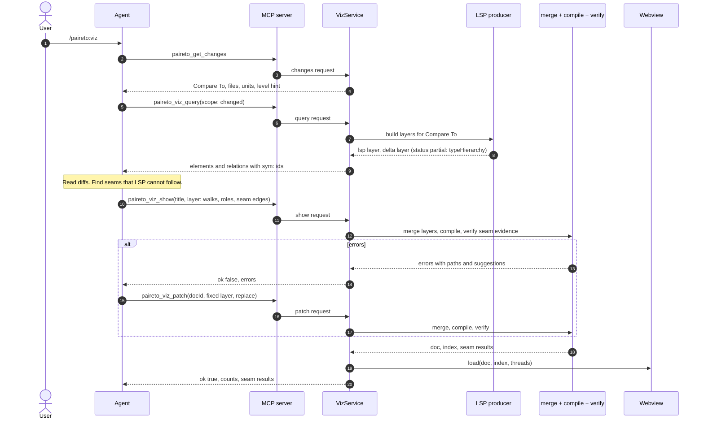
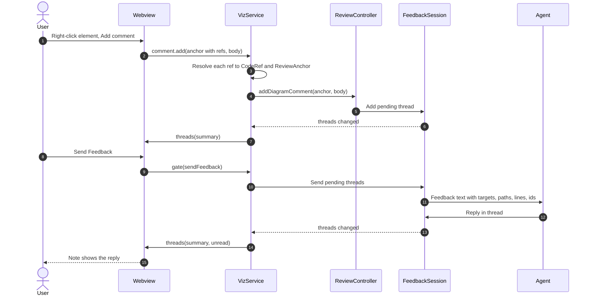

# Shared viz core: protocols

This document describes four protocols:

1. The MCP tools that the agent calls.
2. The host and webview messages.
3. The path from a diagram comment to the agent and back.
4. Code snippet preview.

## 1. MCP tools

The agent has four tools. All are non-blocking, like the #74 tools. Each returns text for the agent and a `structuredContent` object with the same data.

| Tool | Purpose | Replaces |
| --- | --- | --- |
| `paireto_get_changes` | Compare To, changed files, units, level hint | Same tool in #74 |
| `paireto_viz_query` | Read the programmatic graph: ids, kinds, relations, members | New |
| `paireto_viz_show` | Open a view. Optionally add an agent layer | `paireto_show_viz` in #74 |
| `paireto_viz_patch` | Add an agent layer to an open doc | New |

### `paireto_viz_query`

The agent reads ids before it writes. It does not invent ids for code that LSP already knows.

```ts
interface VizQueryArgs {
  scope: "changed" | { paths: string[] } | { around: string[]; hops?: number };
  detail?: "elements" | "members" | "relations";
  kinds?: ElementKind[];
}

interface VizQueryResult {
  docId: string;
  status: "complete" | "partial";
  missing?: string[];
  elements: { id: string; kind: string; label: string; parent?: string; path?: string; delta?: string }[];
  relations?: { id: string; kind: string; from: string; to: string }[];
  truncated?: boolean;
}
```

- `scope: "changed"` returns the elements that the delta layer marks as changed, with their parents.
- `around` returns the neighbourhood of the given ids.
- The result is compact. Ids, kinds and labels only. The agent can read the code itself.
- `status: "partial"` tells the agent which capability is missing, such as `typeHierarchy` for TypeScript. The agent can then add the missing edges as proposals.

### `paireto_viz_show`

```ts
interface VizShowArgs {
  docId?: string;
  base?: "changes" | "none";
  title: string;
  summary?: string;
  layer?: AgentLayer;
  views?: View[];
  open?: ViewId;
}
```

- `base: "changes"` builds the programmatic layers for the current Compare To. This is the default.
- `base: "none"` gives an agent-only doc. This is the #74 mode. It stays for diagrams that have no code, such as a design sketch.
- `views` can be empty. The host then adds the presets: "Changes" (graph), "Types" (class) and one sequence view for each walk.

### `paireto_viz_patch`

```ts
interface VizPatchArgs {
  docId: string;
  layer: AgentLayer;
  replace?: boolean;
}

interface AgentLayer {
  elements?: Element[];
  relations?: Relation[];
  walks?: Walk[];
  tours?: Tour[];
  patches?: Patch[];
}
```

- One agent layer per doc by default. `replace: true` replaces the agent's previous layer. Without it, the host merges the new layer into the old agent layer. A retry with the same content gives the same doc.
- The agent can refer to `sym:` ids from `paireto_viz_query`. Its own ids get the `a:` prefix.

### Results and errors

Both write tools return the same shape. It keeps the #74 error style: every error has a path and a suggestion.

```ts
interface VizWriteResult {
  ok: boolean;
  docId: string;
  counts: { elements: number; relations: number; walks: number };
  errors: { path: string; rule: string; message: string; suggestion?: string }[];
  warnings: { path: string; rule: string; message: string }[];
  seams?: { relation: string; verification: "verified" | "partial" | "unverified" | "failed"; reason?: string }[];
}
```

### Agent flow



## 2. Host and webview messages

The host sends the doc and the index once, then sends small updates. #77 sends the whole model again after each review change. This design does not.

```ts
type HostToWebview =
  | { t: "load"; doc: VizDoc; index: VizIndexData; threads: ThreadSummary[]; window: WindowInfo }
  | { t: "layer"; layer: Layer; index: VizIndexData }
  | { t: "delta"; layer: Layer }
  | { t: "threads"; threads: ThreadSummary[] }
  | { t: "seen"; files: string[] }
  | { t: "snippet"; requestId: string; snippet: Snippet | { error: string } }
  | { t: "focus"; ref: VizRef }
  | { t: "window"; window: WindowInfo };

type WebviewToHost =
  | { t: "ready" }
  | { t: "open"; code: CodeRef; mode: "diff" | "file" }
  | { t: "snippet"; requestId: string; code: CodeRef; context?: number }
  | { t: "comment.add"; anchor: DiagramAnchor; body: string; kind: "comment" | "question" }
  | { t: "comment.reply" | "comment.edit"; threadId: string; body: string }
  | { t: "comment.link" | "comment.unlink"; threadId: string; ref: VizRef }
  | { t: "comment.move"; threadId: string; place: NotePlace }
  | { t: "comment.resolve" | "comment.delete" | "comment.read"; threadId: string }
  | { t: "seen"; path: string; seen: boolean }
  | { t: "gate"; action: "sendFeedback" | "approve" }
  | { t: "viewState"; state: PersistedViewState }
  | { t: "align" }
  | { t: "export"; format: "mermaid" | "d2" | "json"; view: ViewId };
```

- The host checks every incoming message with zod at the boundary, as #74 does.
- `layer` arrives when the agent patches the doc or a producer finishes late. The webview merges it and lays out again only the views that change.
- `delta` arrives when the working tree changes. A delta change does not change the graph shape, so layout often stays the same.
- The comment messages come from #77, with `VizRef` in place of `typeId` and `memberId`.

## 3. Comments on diagram elements

A diagram comment is a `ReviewThread`, as in #77. The change is the anchor.

```ts
interface DiagramAnchor {
  docId: string;
  view: ViewId;
  title: string;
  targets: DiagramTarget[];
  place?: NotePlace;
  readAt?: string;
}

interface DiagramTarget {
  ref: VizRef;
  label: string;
  code?: { ref: CodeRef; anchor: ReviewAnchor };
}

interface NotePlace { ref?: VizRef; x: number; y: number }
```

- Each target keeps a `ReviewAnchor` (line text and context) next to its `CodeRef`. When the code moves, `relocateReviewAnchor` finds the new line. #77 stores a fixed `file:line` copy.
- If the element id is gone after a refresh, the thread still has its code anchor. The note shows as orphaned on the diagram, and it still opens the code. This uses the same idea as `orphanComments.ts`.
- The agent receives the thread through the normal feedback text. Each target renders as `- <label> (<kind>) at <path>:<line>`, plus the element id, so the agent can call `paireto_viz_query` on it.



## 4. Code snippets

The webview asks for a snippet when the user hovers or selects an element. The host reads the text through the same document providers that the diff view uses, so both sides work.

```ts
interface Snippet {
  code: CodeRef;
  language: string;
  startLine: number;
  lines: string[];
  highlight?: { start: number; end: number };
  changes?: { line: number; kind: "added" | "removed" }[];
}
```

- `side: "base"` reads through the `paireto-review:` URI. `side: "modified"` reads the working file.
- `changes` marks added and removed lines, so the preview can show a small inline diff.
- Syntax colours are a webview concern. A library such as Shiki can run in the webview with the VS Code theme colours. This is an open choice.
- The host caches snippets by content id, as #77 caches symbols.

## Exporters

Export is one-way. No Mermaid import. Mermaid has no official parser AST for flowchart, sequence or class diagrams, so import would be a separate project.

| View kind | Mermaid | What is lost |
| --- | --- | --- |
| `graph` | `flowchart` with `subgraph` for parents | Members, evidence, code refs, roles |
| `class` | `classDiagram` with members and UML arrows | Delta detail, code refs |
| `sequence` | `sequenceDiagram` with `alt / opt / loop / par` | Request and response bodies, code refs |

- Delta shows as a prefix glyph and a `classDef` colour.
- The JSON export is the full `VizDoc`. It is the only lossless format.
- D2 is the second exporter. It keeps deep nesting and sequences with less loss than Mermaid.
