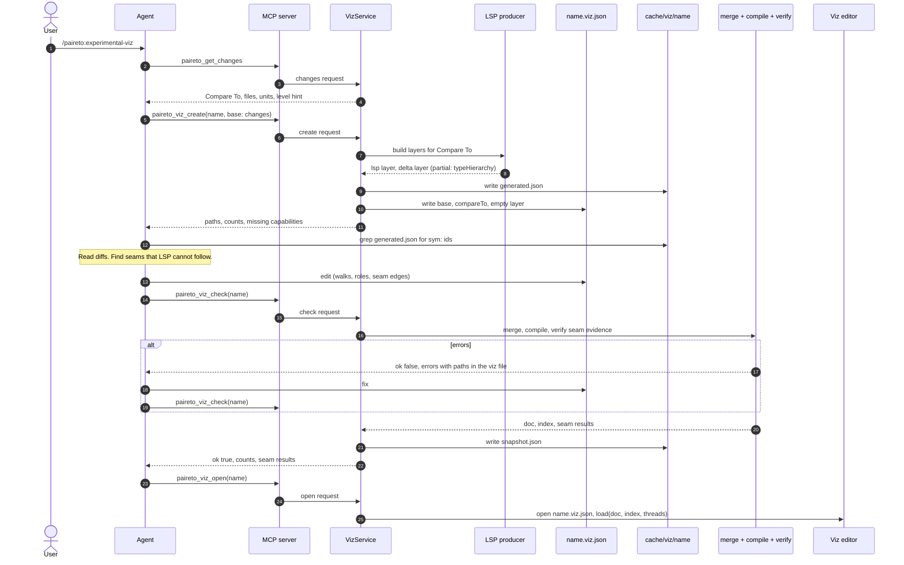
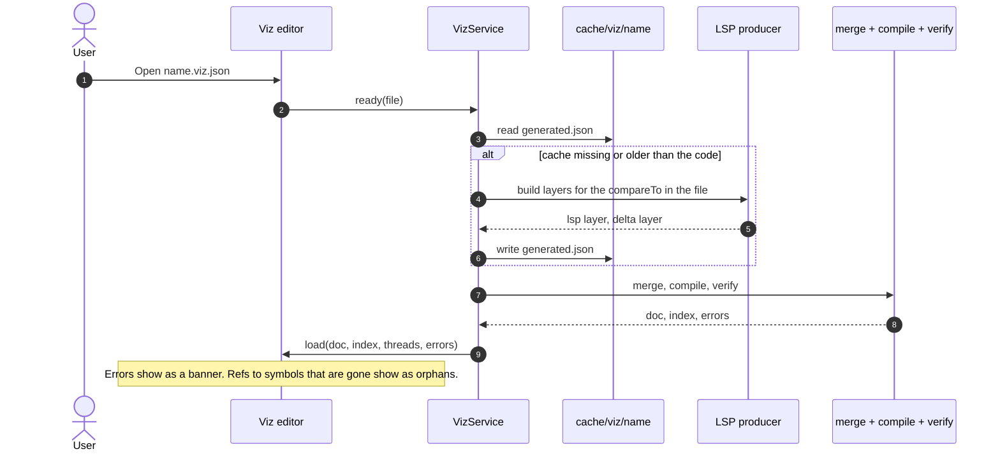
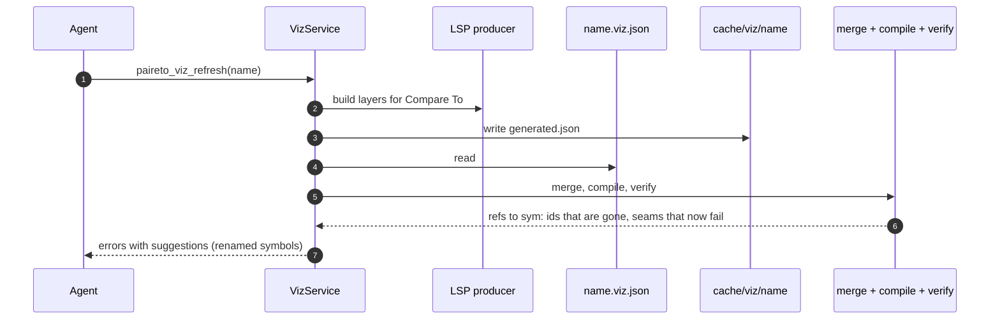
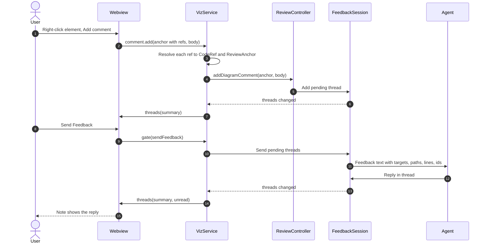

# Shared viz core: protocols

This document describes four protocols:

1. The viz files the agent edits, and the MCP tools around them.
2. The host and webview messages.
3. The path from a diagram comment to the agent and back.
4. Code snippet preview.

## 1. Viz files and MCP tools

A viz is one JSON file that the agent writes with the same file tools it uses for code. MCP tools generate the programmatic part, check the result, and open the viz.

Agents edit files well. A file edit changes a few lines, and the agent does not have to send a 6 to 10 KB payload again on each retry, as it does in #74. The file also stays after the session ends, and a team can commit it.

### Files

```text
<repo root>/.paireto/
  .gitignore                 Paireto writes it. One line: cache/
  viz/
    <name>.viz.json          The viz source: the agent layer. Only the agent writes it
  cache/
    viz/<name>/
      generated.json         Programmatic layers: lsp, delta. Paireto writes it. Read-only for the agent
      snapshot.json          The merged, compiled doc at the last successful check. Paireto writes it
```

Rules:

- **One writer for each file.** The agent writes `<name>.viz.json`. Paireto writes everything under `cache/`. A refresh of the generated layer never erases the agent's work.
- **User state is not in these files.** Comments stay in the review store as `ReviewThread`s. Node positions, zoom and filters stay in `workspaceState`. So the user and the agent never write the same file.
- **The user decides what to commit.** Paireto does not change the user's `.gitignore` or `.git/info/exclude`. A new viz file shows in the Changes list like any other new file. The user can review it, commit it, or ignore it.
- **The cache is not source.** `generated.json` and `snapshot.json` come from the code and the viz file, so Paireto can build them again at any time. The `.paireto/.gitignore` file ignores only `cache/`. It is inside Paireto's own folder, and it never ignores a viz file. When a colleague opens a committed viz, Paireto builds the cache from their checkout.
- **`generated.json` is the query surface.** The agent finds `sym:` ids with `grep` or by reading the file. There is no separate query tool. The file holds the changed files and one hop of neighbours, so it stays small.
- **Schema without a `$schema` line.** Paireto contributes `jsonValidation` for `**/.paireto/viz/*.viz.json` with the schema that ships in the extension. VS Code checks the file for a human. The agent gets the schema from the skill.

```jsonc
{
  "title": "Order checkout",
  "summary": "Adds a billing step after an order is created.",
  "base": "changes",
  "compareTo": { "kind": "mergeBase" },
  "elements": [
    { "id": "order-created", "kind": "topic", "label": "orders.created" }
  ],
  "relations": [
    {
      "kind": "publishes",
      "from": { "element": "sym:orders-api/events/publish.go#PublishOrderCreated" },
      "to": { "element": "order-created" },
      "evidence": [{ "at": { "repo": "orders-api", "path": "events/publish.go", "side": "modified", "range": { "start": 41, "end": 41 } }, "key": "orders.created" }]
    }
  ],
  "patches": [
    { "op": "annotate", "ref": { "element": "sym:orders-api/handlers/orders.go#CreateOrder" }, "role": "Accepts the order and publishes the event." }
  ],
  "walks": [],
  "tours": [],
  "views": []
}
```

`base` and `compareTo` are in the viz file, not only in the tool call. Paireto needs them to build the cache again for a colleague, or after a restart.

### Opening a viz

A viz opens in a **custom editor**, not in a separate panel. Paireto contributes a `CustomTextEditorProvider` for `*.viz.json` with `priority: "default"`.

| Entry point | What opens |
| --- | --- |
| The user opens a `.viz.json` file from the Explorer, Quick Open or the Changes list | That viz. "Reopen Editor With > Text Editor" shows the JSON |
| The viz button on the Changed Files row (the #77 button) | The most recently changed viz file in the repo |
| `Paireto: Open Viz` | A quick pick of all viz files, newest first |
| The switcher in the viz header | The same list. A choice opens that viz in the same tab |
| `paireto_viz_open` from the agent | The named viz, at a view and a focus if given |

- "Most recent" means the newest modification time of a `.viz.json` file. The agent's last edit updates it, so the newest agent work wins.
- In a multi-root window the button uses the repo of its row. The quick pick and the switcher list every repo and show the repo name.
- The button shows only when at least one repo in the window holds a viz file. The `paireto.hasViz` context key controls it.
- The editor never writes the file. It is a read-only view of the `TextDocument`. The one-writer rule holds.
- If the cache is missing or stale, the editor builds it before it draws. A `base: "changes"` viz needs LSP for this, but not the agent.

### MCP tools

| Tool | Purpose | Replaces |
| --- | --- | --- |
| `paireto_get_changes` | Compare To, changed files, units, level hint | Same tool in #74 |
| `paireto_viz_create` | Write `<name>.viz.json` with `base` and `compareTo`. Build the cache | New |
| `paireto_viz_check` | Merge, compile and verify. Write `snapshot.json`. Return errors | The validation half of `paireto_show_viz` |
| `paireto_viz_open` | Open the viz editor at a view and a focus | The panel half of `paireto_show_viz` |
| `paireto_viz_refresh` | Build `generated.json` again for the current Compare To. Report agent refs that broke | New |
| `paireto_viz_list` | List the viz files, their Compare To and the date of the last check | #74 history picker |

```ts
interface VizCreateArgs {
  name: string;
  base: "changes" | "none";
  scope?: { paths?: string[]; hops?: number };
}

interface VizCreateResult {
  file: string;
  generated: string;
  status: "complete" | "partial";
  missing?: string[];
  counts: { elements: number; relations: number };
}

interface VizCheckArgs { name: string }
interface VizOpenArgs { name: string; view?: ViewId; focus?: VizRef }
interface VizRefreshArgs { name: string }
```

- `base: "changes"` builds the LSP and delta layers for the current Compare To.
- `base: "none"` writes an empty `generated.json`. The agent draws everything, as in #74. It costs nothing extra, because it is the same pipeline with an empty programmatic layer.
- The agent chooses the base. The tool has no default, so the agent must make the choice each time.
- `status: "partial"` names the capabilities that are missing, such as `typeHierarchy` for TypeScript. The agent can then add those edges with evidence.
- If the viz file does not set `views`, Paireto adds the presets: "Changes" (graph), "Types" (class) and one sequence view for each walk.

### Choosing a base

The skill tells the agent how to choose. The two modes are equal. Neither is a fallback.

| Use `base: "changes"` when | Use `base: "none"` when |
| --- | --- |
| The diagram is about code structure: types, modules, calls | The diagram is about concepts the code does not name: a business process, a deploy topology, a trust boundary |
| The user wants to see what a change touches | The diagram is a design for code that does not exist yet, such as during plan review |
| The languages have good LSP support | The diagram crosses many repos or systems that are not open in the window |
| The agent wants Paireto to keep the diagram true as code changes | The diagram is a one-off explanation, and a hand layout is clearer than the full graph |

A bespoke diagram can still point at code.

- Its elements, relations and steps can carry `code` refs. Paireto checks that each file and range exists, as #74 does.
- Comments, snippets and "open diff" work on any element that has a `code` ref.
- With `base: "changes"`, a bespoke view is also possible. The agent sets `views` to include only its own elements, and it refers to `sym:` ids where it wants a live link to a symbol. The generated graph stays in the doc but does not show in that view.

### Check result

`paireto_viz_check` and `paireto_viz_refresh` return the same shape. It keeps the #74 error style. Every error has a path into the viz file and a suggestion.

```ts
interface VizCheckResult {
  ok: boolean;
  counts: { elements: number; relations: number; walks: number };
  errors: { path: string; rule: string; message: string; suggestion?: string }[];
  warnings: { path: string; rule: string; message: string }[];
  seams?: { relation: string; verification: "verified" | "partial" | "unverified" | "failed"; reason?: string }[];
}
```

### Live updates

The viz editor follows its `TextDocument`. When the agent saves the file, VS Code reloads the document, and Paireto checks it again.

- If the check passes, the editor shows the new doc.
- If the check fails, the editor keeps the last good doc and shows an error banner. The same errors appear as VS Code diagnostics on the file.
- The agent still calls `paireto_viz_check` to get the errors as a tool result. The live update is for the human who watches the editor.

### Agent flow



### Opening a committed viz



### Refresh after code changes



## 2. Host and webview messages

The host sends the doc and the index once, then sends small updates. #77 sends the whole model again after each review change. This design does not.

```ts
type HostToWebview =
  | { t: "load"; doc: VizDoc; index: VizIndexData; threads: ThreadSummary[]; window: WindowInfo }
  | { t: "layer"; layer: Layer; index: VizIndexData }
  | { t: "delta"; layer: Layer }
  | { t: "threads"; threads: ThreadSummary[] }
  | { t: "seen"; files: string[] }
  | { t: "snippet"; requestId: string; snippet: Snippet | { error: string } }
  | { t: "focus"; ref: VizRef }
  | { t: "window"; window: WindowInfo };

type WebviewToHost =
  | { t: "ready" }
  | { t: "open"; code: CodeRef; mode: "diff" | "file" }
  | { t: "snippet"; requestId: string; code: CodeRef; context?: number }
  | { t: "comment.add"; anchor: DiagramAnchor; body: string; kind: "comment" | "question" }
  | { t: "comment.reply" | "comment.edit"; threadId: string; body: string }
  | { t: "comment.link" | "comment.unlink"; threadId: string; ref: VizRef }
  | { t: "comment.move"; threadId: string; place: NotePlace }
  | { t: "comment.resolve" | "comment.delete" | "comment.read"; threadId: string }
  | { t: "seen"; path: string; seen: boolean }
  | { t: "gate"; action: "sendFeedback" | "approve" }
  | { t: "viewState"; state: PersistedViewState }
  | { t: "align" }
  | { t: "export"; format: "mermaid" | "d2" | "json"; view: ViewId };
```

- The host checks every incoming message with zod at the boundary, as #74 does.
- `layer` arrives when the viz file passes a check, or when a producer finishes late. The webview merges it and lays out again only the views that change.
- `delta` arrives when the working tree changes. A delta change does not change the graph shape, so layout often stays the same.
- The comment messages come from #77, with `VizRef` in place of `typeId` and `memberId`.

## 3. Comments on diagram elements

A diagram comment is a `ReviewThread`, as in #77. The change is the anchor.

```ts
interface DiagramAnchor {
  viz: string;
  view: ViewId;
  title: string;
  targets: DiagramTarget[];
  place?: NotePlace;
  readAt?: string;
}

interface DiagramTarget {
  ref: VizRef;
  label: string;
  code?: { ref: CodeRef; anchor: ReviewAnchor };
}

interface NotePlace { ref?: VizRef; x: number; y: number }
```

- Each target keeps a `ReviewAnchor` (line text and context) next to its `CodeRef`. When the code moves, `relocateReviewAnchor` finds the new line. #77 stores a fixed `file:line` copy.
- If the element id is gone after a refresh, the thread still has its code anchor. The note shows as orphaned on the diagram, and it still opens the code. This uses the same idea as `orphanComments.ts`.
- The agent receives the thread through the normal feedback text. Each target renders as `- <label> (<kind>) at <path>:<line>`, plus the element id, so the agent can find it in `generated.json` or the viz file.



## 4. Code snippets

The webview asks for a snippet when the user hovers or selects an element. The host reads the text through the same document providers that the diff view uses, so both sides work.

```ts
interface Snippet {
  code: CodeRef;
  language: string;
  startLine: number;
  lines: string[];
  highlight?: { start: number; end: number };
  changes?: { line: number; kind: "added" | "removed" }[];
}
```

- `side: "base"` reads through the `paireto-review:` URI. `side: "modified"` reads the working file.
- `changes` marks added and removed lines, so the preview can show a small inline diff.
- Syntax colours are a webview concern. A library such as Shiki can run in the webview with the VS Code theme colours. This is an open choice.
- The host caches snippets by content id, as #77 caches symbols.

## Exporters

Export is one-way. No Mermaid import. Mermaid has no official parser AST for flowchart, sequence or class diagrams, so import would be a separate project.

| View kind | Mermaid | What is lost |
| --- | --- | --- |
| `graph` | `flowchart` with `subgraph` for parents | Members, evidence, code refs, roles |
| `class` | `classDiagram` with members and UML arrows | Delta detail, code refs |
| `sequence` | `sequenceDiagram` with `alt / opt / loop / par` | Request and response bodies, code refs |

- Delta shows as a prefix glyph and a `classDef` colour.
- The JSON export is the full `VizDoc`. It is the only lossless format.
- D2 is the second exporter. It keeps deep nesting and sequences with less loss than Mermaid.
- A LikeC4 exporter writes graph views as LikeC4 views and walks as dynamic views. See [06-likec4.md](06-likec4.md).
