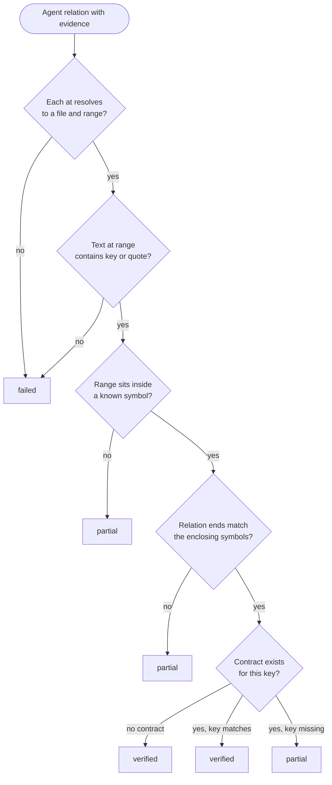

# Shared viz core: cross-language seams

LSP follows symbols inside one language and one project. It does not follow an HTTP call, a queue message or an RPC across a service boundary. This document describes how the core finds those seams.

## Answer in short

Yes. Build the graph inside each language with LSP. Then let other producers, and the agent, add seam edges between those graphs. Every seam edge carries evidence. Paireto checks the evidence and shows how sure it is.

This "a model proposes, a tool checks" pattern has support in research. IRIS (ICLR 2025) has an LLM write taint specs that CodeQL then checks. A 2025 benchmark found that LLMs build call graphs less accurately than a static tool. So the agent proposes edges, and Paireto does not trust them without a check.

## Seam producers

Each producer writes its own layer. Confidence goes down the list.

| Order | Source | What it finds | Confidence |
| --- | --- | --- | --- |
| 1 | `lsp` | Symbols and relations inside one language | High where the capability exists |
| 2 | `contract` | Endpoints from OpenAPI, AsyncAPI, `.proto` and GraphQL files. Handler and client sites linked by key | High |
| 3 | `config` | Services and links from docker-compose, k8s, Dapr components, Backstage `providesApis` / `consumesApis` | Medium |
| 4 | `runtime` | Edges and sequences from OpenTelemetry traces. A CLIENT span and its SERVER child make one edge | High, when traces exist |
| 5 | `agent` | Seam edges the agent proposes with evidence | Depends on verification |

Phase 1 needs only `lsp` and `agent`. The others are later additions to the same model.

## The seam as a model

A seam is an `endpoint` or `topic` element in the middle, with a relation on each side. It is not a direct edge from client to handler. This gives the key a place on the diagram, and both sides can join to it.

```mermaid
flowchart LR
  subgraph web["web (TypeScript)"]
    client["sym:web/src/api/orders.ts#createOrder"]
  end
  subgraph api["orders-api (Go)"]
    handler["sym:orders-api/handlers/orders.go#CreateOrder"]
    publisher["sym:orders-api/events/publish.go#PublishOrderCreated"]
  end
  subgraph worker["billing-worker (Python)"]
    consumer["sym:billing-worker/consumers.py#on_order_created"]
  end
  endpoint(["a:post-orders<br/>endpoint POST /orders"])
  topic[["a:order-created<br/>topic orders.created"]]

  client -- "http (agent, verified)" --> endpoint
  endpoint -- "http (agent, verified)" --> handler
  handler -- "calls (lsp)" --> publisher
  publisher -- "publishes (agent, partial)" --> topic
  topic -- "subscribes (agent, unverified)" --> consumer
```



When a contract producer runs, the endpoint id becomes `api:openapi.yaml#POST /orders`, and the agent links to that id. Without a contract, the agent makes the endpoint with an `a:` id.

## Evidence

```ts
interface Evidence {
  at: CodeRef;
  key: string;
  quote?: string;
  contract?: { path: string; pointer: string };
}
```

- `at` is the place in code: the `fetch` call, the route decorator, the `publish` call.
- `key` is the join value: `POST /orders`, `orders.created`, `orders.v1.OrderService/Create`.
- `quote` is the text the agent saw at that place. It is optional, and it makes the check stronger.

## Verification

The host runs these checks on each agent relation that has evidence.



- A relation with no evidence is `unverified`.
- The canvas draws `verified` as a solid line, `partial` as a dashed line, and `unverified` and `failed` with a warning mark. A filter hides all edges that are not verified.
- The write result lists each seam and its status, so the agent can add better evidence.
- Verification is pure apart from reading text and symbols. It runs again when the code changes. An edge whose evidence no longer matches changes to `failed`, and the thread or tour that refers to it keeps working.

## LSP coverage

Only document symbols, workspace symbols, references and definition work in all the main language servers. The LSP producer probes the rest for each language and records gaps in `Layer.missing`.

| Server | Symbols, references | Implementation | Call hierarchy | Type hierarchy |
| --- | --- | --- | --- | --- |
| tsserver (VS Code TS) | yes | yes | yes | no |
| pyright / Pylance | yes | pyright no, Pylance partial | yes | Pylance yes, pyright likely no |
| gopls | yes | yes | yes, no dynamic calls | yes since v0.19 |
| rust-analyzer | yes | yes | yes | no |
| jdtls | yes | yes | yes | yes |
| clangd | yes | yes | outgoing since clangd 20 | yes |
| Roslyn / C# Dev Kit | yes | yes | in the Roslyn source, not confirmed in Dev Kit | in the Roslyn source |

The research subagent took this table from release notes and issues. Some cells are inferred. It must be checked with a probe before we depend on it.

How the producer fills relations, best source first:

1. `extends` / `implements`: type hierarchy, then implementation provider, then the #77 header text parse. Each source sets its own confidence.
2. `calls`: outgoing call hierarchy, then references from inside a function's range.
3. `association`: the declared type of a field, resolved through definition on the type name. #77 matches short names, which picks the wrong type when two have the same name.
4. `imports`: document links or definition on import statements.

A relation from the text parse is marked `attrs.inferred = true`, and the UI shows it as low confidence.

## Cost

LSP calls are slow on a cold project. The producer:

- Works only on the changed files and one hop of neighbours by default.
- Caches results by content id, as #77 does.
- Runs references and call hierarchy only on changed members, not on every symbol.
- Sends a `partial` layer first and a `layer` update when slow queries finish.
