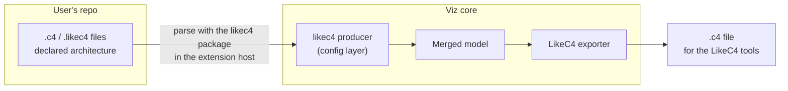

# Shared viz core: LikeC4

This document records whether the core uses [LikeC4](https://likec4.dev) as its model and renderer, or keeps its own model and works with LikeC4 at the edges.

The facts below come from the LikeC4 source at v1.61.0 (released 2026-11-14), its docs, npm, and a test bundle. Items marked *inferred* were not checked in the source.

## Decision

Open. A short spike decides it. See [Spike](#spike).

LikeC4 can carry most of the interactivity we want through metadata and its customisation points. See [Extending LikeC4](#extending-likec4). The gaps that are left are structural. They are class boxes with member rows and edges that end at a member, data on sequence steps, ids from code symbols, and the size of the webview bundle. The spike tests whether the first gap can be closed without a fork. That gap decides whether LikeC4 can be the only renderer.

There are two paths:

- **A. Own model and renderer.** Port the #74 renderer and add a class box. LikeC4 is an export target and a later import producer.
- **B. LikeC4 model and renderer, extended.** Generate LikeC4 models with the `Builder`. Carry our extra data in metadata. Add interactivity with `renderNodes`, UI slots and canvas children. We get its sequence renderer, walkthrough, relationship browser and search with no work.

## Fit

| Need | Fit | Why |
| --- | --- | --- |
| Architecture and component graphs | Good | The main use case. Kinds, nesting, tags, metadata, links |
| Step playback | Good | `enableDynamicViewWalkthrough` and a sequence outline panel |
| Agent fluency | Good | An official `likec4-dsl` agent skill, `llms.txt`, and an MCP server |
| Metadata | Partial | On elements and relations. Values are strings, booleans or string arrays. Structured data goes in a JSON string. Duplicate keys merge into arrays. Not on dynamic view steps |
| Programmatic generation | Partial | A typed `Builder` and `generate()` to DSL text exist. There is no JSON Schema for the model, only TypeScript types |
| Generated layer plus agent layer | Partial | `extend` in another file adds children, relations, tags and metadata. It cannot remove or hide. When a refresh drops an element, the agent's `extend` of it becomes a parse error, not an orphan (inferred) |
| Sequence diagrams | Partial | `variant sequence` with `alt / opt / loop / par / break / try` frames since 1.59.0, marked experimental. Steps have no metadata or tags, so no code refs or delta on a step. Steps connect leaf elements only |
| Delta overlay | Partial | Nodes and edges have `diffStatus` since 1.61.0. That describes planned model changes, not a git diff. Nothing at member level, and no `signature` vs `body` |
| Code refs | Partial | A relative `link` with a line range. No diff side |
| Mermaid export | Partial | Flowchart only. Sequence export is an open issue |
| Comments, snippets, badges on elements | Good | `renderNodes` with the `@likec4/diagram/custom` primitives, `ElementActions` extra buttons, metadata read in the node, canvas children and `ViewportPortal`. See [Extending LikeC4](#extending-likec4) |
| New node or edge types | Poor | `renderNodes` replaces renderers for the existing node types only. There is no `renderEdges` prop. Edge points come from the layout |
| UML class boxes, edges from a member | Poor | No compartment concept. A member as a child element draws as a nested box placed by Graphviz, not as a row |
| Symbol ids | Poor | Ids match `([a-zA-Z]\|_+[a-zA-Z0-9])[-\w]*`, and `.` separates nesting levels. `src/a.ts#Foo.bar` needs a mapping |
| Webview bundle | Poor | About 2.16 MB minified (702 KB gzip) plus 424 KB of CSS, measured. It brings Mantine, motion and xstate. It pins `react` to exactly `19.3.1` |
| Layout | Poor for us | Graphviz WASM and a constraint solver for sequences. No ELK option. The renderer needs a view that already has positions |

## Extending LikeC4

This table maps each interaction we want to a LikeC4 mechanism. "Source" names where the mechanism is documented.

| Interaction | Mechanism | Source | Works |
| --- | --- | --- | --- |
| Delta badge, line counts, verification mark | Metadata keys read in a custom `element` renderer. Tags such as `#added` with tag styles for colour | `tooling/react.mdx` custom node renderers, `dsl/model.mdx` metadata | Yes |
| Add a comment on an element | An `ElementActions` extra button. `onNodeClick` and the context menu events | `tooling/react.mdx` | Yes |
| Comment notes on the canvas | `ViewportPortal` children placed at node positions from the diagram API | `tooling/react.mdx` children and portals | Yes, but notes are not in the layout, so they can cover nodes |
| Code snippet on hover | A popover in the custom `element` renderer. The `CodeRef` is JSON in a metadata string | `tooling/react.mdx` | Yes |
| Open diff at a line | `onOpenSource`, or a node button that posts to the host | `LikeC4Diagram.props.ts` | Yes |
| Shell changes (header, switcher) | The `LikeC4Diagram` slot with `wrap`, plus xyflow `Panel` children | `tooling/customization.mdx` | Yes. Slots are marked experimental |
| Flow playback | `enableDynamicViewWalkthrough` | `LikeC4Diagram.props.ts` | Yes |
| Class box with member rows | A custom `element` renderer that draws rows from a members metadata string | `tooling/react.mdx` | Unknown. The layout sets the node size from the title, the description and the `size` style, not from our rows |
| Edge that ends at a member row | Edge points come from the layout. No edge renderer override | `likec4diagram/types.ts`, `LikeC4Diagram.props.ts` | Unknown. Only possible if we supply the layout |
| Comment or code ref on a sequence step | Steps have `title`, `description`, `technology`, `notes` and `navigateTo`. No metadata | `dsl/Views/dynamic.mdx` | Partly. A ref can go in Markdown `notes`, but not as data |
| Comment on a member | A member must be a selectable thing. In LikeC4 that means a child element, which draws as a nested box | `dsl/model.mdx` | Only with a custom class box |

The cost of path B is that every extra field is a JSON string in metadata. The viz file is then LikeC4 DSL, or `Builder` data, and not our zod schema. So the agent gets parse diagnostics from the LikeC4 language server instead of our path-located errors. Our checks on code refs and evidence would run on parsed metadata strings.

## Spike

The spike runs outside the repo and takes the `@likec4/diagram` package in a plain React page. It answers four questions. Each has a pass condition.

1. **Class box.** A custom `element` renderer draws 12 member rows, and the node is tall enough for them. Pass if we can set the node size without a fork: through a style, or by giving `LikeC4Diagram` a `LayoutedView` with our own sizes.
2. **Member edges.** An edge ends at the third row of a class box. Pass if a `LayoutedView` that we lay out with ELK ports draws the edge to that point.
3. **Refresh.** A generated file and an agent file that uses `extend` on a generated element. Then the generated element is removed. Pass if we can find the broken `extend` and show it as an orphan, not lose the whole model.
4. **Weight.** Measure the webview bundle with our customisations, and the time to first draw for a 300-node view inside a VS Code webview.

Outcomes:

- All four pass: take path B. LikeC4 renders every view. Our core keeps the producers, the delta and verification logic, and the comment integration. It writes LikeC4 models.
- 1 or 2 fails: take path A. Two renderers in one webview, with two style systems and two xyflow canvases, would cost more than our own renderer.
- Only 3 or 4 fails: path B is still possible with our own layer merge before the `Builder`, or with lazy loading of the renderer.

## What we take from LikeC4

- **A kind specification.** LikeC4 declares element kinds, relation kinds and tags, with their styles, in a `specification` block. Our open `x:` kinds need the same thing, so that the agent can declare a kind and its style once in the viz file. This replaces a hard-coded style for each kind.
- **Tag styling.** `style element.tag = #added { ... }` puts the look in the view, not in the renderer. Our delta and verification styles can use one mechanism with user and agent tags.
- **Fragment vocabulary.** Our `Step.fragment` uses the same words as LikeC4: `alt`, `opt`, `loop`, `par`, `break`, `try`. Export to LikeC4 is then direct.
- **Compare views.** LikeC4 shows As-is, Changes and To-be on one shared layout. We want the same thing for base and modified. The layout runs once over the merged graph, and the delta decides what each mode shows.
- **`extend` across files.** This confirms the layer design. Our version adds `hide`, and keeps a ref to a gone element as an orphan, not an error.

## Where LikeC4 connects

- **Import as a producer.** If a repo already has a LikeC4 model, it is a declared architecture with named systems and relations. The `config` producer reads it in the extension host with the `likec4` package, so no LikeC4 code goes into the webview. Its relations are seams that the agent does not have to find. This is a later phase.
- **Export.** An exporter writes graph views as LikeC4 elements and views, and walks as dynamic views with `variant sequence`. Members become metadata, and symbol ids become sanitised ids with the real id in metadata. This gives a user the LikeC4 tools, its sequence export and its MCP server for their own docs.
- **File extension.** The viz file stays `.viz.json`. A `.c4` file in `.paireto/` would join the user's LikeC4 model if they have the LikeC4 extension installed (inferred from its `workspaceContains` activation), and ids could clash.

## When to look at this again (path A)

If we take path A, look at the decision again if LikeC4 adds all three of these:

- Compartments or member rows on a node.
- A way to register new node and edge types in `@likec4/diagram`.
- Metadata on dynamic view steps.

With those three, the gap is the id mapping and the bundle size. Those might be a fair price for a shared ecosystem.
