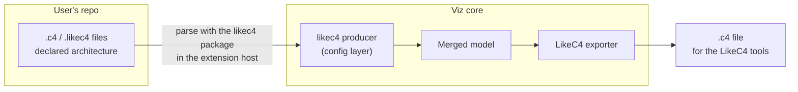

# Shared viz core: LikeC4

This document records whether the core uses [LikeC4](https://likec4.dev) as its model and renderer, or keeps its own model and works with LikeC4 at the edges.

The facts below come from the LikeC4 source at v1.61.0 (released 2026-11-14), its docs, npm, and a test bundle. Items marked *inferred* were not checked in the source.

## Decision

Keep our own model and our own ReactFlow renderer. Treat LikeC4 as a format we export to and import from. Copy its best design ideas.

LikeC4 is a strong fit for architecture graphs, dynamic views and walkthroughs. It is a poor fit for three things this core must do well. Those are class boxes with members, ids that come from code symbols, and custom node and edge types for comments and code. Each of those needs a fork or a mapping layer, and a fork of a project that releases a breaking minor version about once a month costs more than our own model.

## Fit

| Need | Fit | Why |
| --- | --- | --- |
| Architecture and component graphs | Good | The main use case. Kinds, nesting, tags, metadata, links |
| Step playback | Good | `enableDynamicViewWalkthrough` and a sequence outline panel |
| Agent fluency | Good | An official `likec4-dsl` agent skill, `llms.txt`, and an MCP server |
| Programmatic generation | Partial | A typed `Builder` and `generate()` to DSL text exist. There is no JSON Schema for the model, only TypeScript types |
| Generated layer plus agent layer | Partial | `extend` in another file adds children, relations, tags and metadata. It cannot remove or hide. When a refresh drops an element, the agent's `extend` of it becomes a parse error, not an orphan (inferred) |
| Sequence diagrams | Partial | `variant sequence` with `alt / opt / loop / par / break / try` frames since 1.59.0, marked experimental. Steps have no metadata or tags, so no code refs or delta on a step. Steps connect leaf elements only |
| Delta overlay | Partial | Nodes and edges have `diffStatus` since 1.61.0. That describes planned model changes, not a git diff. Nothing at member level, and no `signature` vs `body` |
| Code refs | Partial | A relative `link` with a line range. No diff side |
| Mermaid export | Partial | Flowchart only. Sequence export is an open issue |
| Comments, snippets, custom nodes | Partial | `renderNodes` replaces renderers for existing node types. Arbitrary React can sit on the canvas. No custom edge renderer and no new node types |
| UML class boxes, edges from a member | Poor | No compartment concept. A member as a child element draws as a nested box placed by Graphviz, not as a row |
| Symbol ids | Poor | Ids match `([a-zA-Z]\|_+[a-zA-Z0-9])[-\w]*`, and `.` separates nesting levels. `src/a.ts#Foo.bar` needs a mapping |
| Webview bundle | Poor | About 2.16 MB minified (702 KB gzip) plus 424 KB of CSS, measured. It brings Mantine, motion and xstate. It pins `react` to exactly `19.3.1` |
| Layout | Poor for us | Graphviz WASM and a constraint solver for sequences. No ELK option. The renderer needs a view that already has positions |

## What we take from LikeC4

- **A kind specification.** LikeC4 declares element kinds, relation kinds and tags, with their styles, in a `specification` block. Our open `x:` kinds need the same thing, so that the agent can declare a kind and its style once in the viz file. This replaces a hard-coded style for each kind.
- **Tag styling.** `style element.tag = #added { ... }` puts the look in the view, not in the renderer. Our delta and verification styles can use one mechanism with user and agent tags.
- **Fragment vocabulary.** Our `Step.fragment` uses the same words as LikeC4: `alt`, `opt`, `loop`, `par`, `break`, `try`. Export to LikeC4 is then direct.
- **Compare views.** LikeC4 shows As-is, Changes and To-be on one shared layout. We want the same thing for base and modified. The layout runs once over the merged graph, and the delta decides what each mode shows.
- **`extend` across files.** This confirms the layer design. Our version adds `hide`, and keeps a ref to a gone element as an orphan, not an error.

## Where LikeC4 connects

- **Import as a producer.** If a repo already has a LikeC4 model, it is a declared architecture with named systems and relations. The `config` producer reads it in the extension host with the `likec4` package, so no LikeC4 code goes into the webview. Its relations are seams that the agent does not have to find. This is a later phase.
- **Export.** An exporter writes graph views as LikeC4 elements and views, and walks as dynamic views with `variant sequence`. Members become metadata, and symbol ids become sanitised ids with the real id in metadata. This gives a user the LikeC4 tools, its sequence export and its MCP server for their own docs.
- **File extension.** The viz file stays `.viz.json`. A `.c4` file in `.paireto/` would join the user's LikeC4 model if they have the LikeC4 extension installed (inferred from its `workspaceContains` activation), and ids could clash.

## When to look at this again

Look at this decision again if LikeC4 adds all three of these:

- Compartments or member rows on a node.
- A way to register new node and edge types in `@likec4/diagram`.
- Metadata on dynamic view steps.

With those three, the gap is the id mapping and the bundle size. Those might be a fair price for a shared ecosystem.
